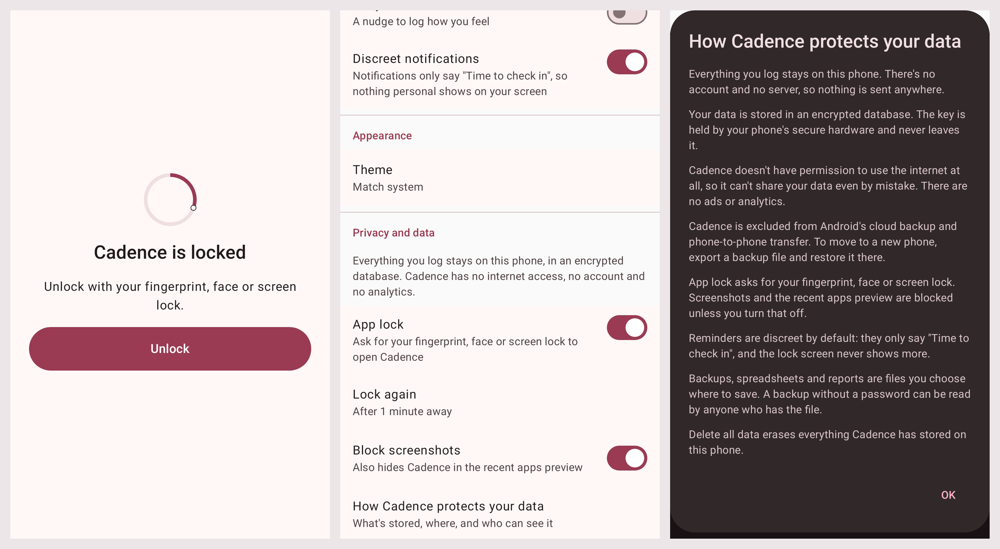

# Cadence

A simple, private period-tracking companion app for **Android**, built natively with Kotlin and Jetpack Compose.

- **Device only:** no account and no server. The app doesn't even hold the `INTERNET` permission; its only permissions are for showing reminders, re-arming them after a reboot, and showing the system's fingerprint or screen-lock prompt for the optional app lock.
- **Encrypted:** data is stored in a SQLCipher database whose key is protected by the Android Keystore.
- **Two modes:** cycle tracking and hormonal birth control.
- **Sideloaded:** distributed as an APK; no Play Store required.

> **Status:** Phases 0 (foundation), 1 (MVP: onboarding, one-tap period logging, predictions, calendar, settings) 2 (daily logging: symptoms, mood, pain, energy, sleep, stress, sex, notes) 3 (confidence-ranged predictions, fertile window, Insights with health flags), 4 (discreet reminders) and 5 (app lock, screenshot blocking, password-protected backup and restore, CSV export, clinician PDF report) are done. See [`docs/PLAN.md`](docs/PLAN.md) for the feature inventory, architecture, data model, prediction engine and phased roadmap.



## Project layout

| Module | What's in it |
|---|---|
| `:app` | Activity, navigation shell, Hilt setup, manifest and privacy settings |
| `:core:domain` | Pure Kotlin cycle logic (no Android dependency), 100% coverage enforced |
| `:core:data` | Room on SQLCipher, Keystore-wrapped database key, DAOs, migrations |
| `:core:ui` | Cadence theme (fixed palette, contrast-tested), cycle ring, stepper, shared composables |
| `:core:testing` | Fake repositories and test rules shared by feature and app tests |
| `:feature:*` | Onboarding, Today, Calendar, daily log sheet, Insights, Settings, reminders (alarms and notifications), backup (backup and restore, CSV, clinician PDF) |
| `build-logic/` | Gradle convention plugins shared by all modules |

## Building

Requirements: JDK 17+ and an Android SDK with platform `android-37.0` (compile only; the app targets API 36 and runs on Android 8.0+).

```bash
echo "sdk.dir=/path/to/android-sdk" > local.properties   # or set ANDROID_HOME

./gradlew assembleDebug                 # → app/build/outputs/apk/debug/app-debug.apk
./gradlew testDebugUnitTest :core:domain:test :core:domain:koverVerify
./gradlew ktlintCheck lint
./gradlew :core:data:connectedDebugAndroidTest :feature:backup:connectedDebugAndroidTest   # needs a device or emulator
scripts/check-apk-permissions.sh app/build/outputs/apk/debug/app-debug.apk
```

CI (`.github/workflows/ci.yml`) runs all of the above, plus device tests on Android 8.0 (API 26) and Android 16 (API 36) emulators. The debug APK is attached to every CI run as an artifact.

## Installing (sideload)

1. Download the APK onto your phone.
2. Open it, and allow your browser or file manager to **install unknown apps** when Android asks.
3. To update, install a newer APK over the existing one. Your data is kept.
4. To move to a new phone, use **Settings → Privacy and data → Export a backup**, copy the file across, and tap **Restore from a backup** on the new phone's welcome screen. Android's own cloud backup and phone transfer deliberately skip Cadence.

Debug builds install as **Cadence (debug)** with the ID `app.cadence.debug`, so they can sit alongside a release build. Signed release APKs with published checksums arrive in Phase 7.

## Disclaimer

Cadence is not a medical device and must not be used as contraception. Predictions are estimates. Talk to a clinician about any health concerns.
