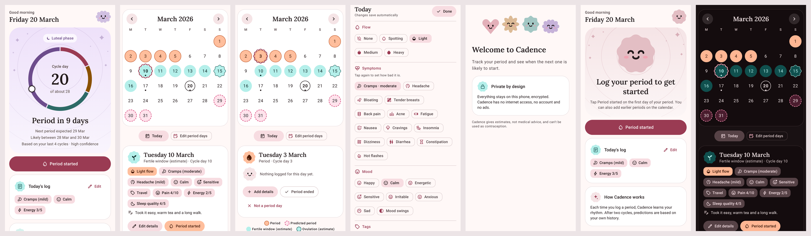

# Cadence

A simple, private period-tracking companion app for **Android**, built natively with Kotlin and Jetpack Compose.

- **Device only:** no account and no server. The app doesn't even hold the `INTERNET` permission. Its other permissions are for reminders (showing them, and re-arming them after a reboot), the system's fingerprint or screen-lock prompt for the optional app lock, and the optional Health Connect sharing (menstruation data only, and only when you turn it on).
- **Encrypted:** data is stored in a SQLCipher database whose key is protected by the Android Keystore.
- **Two modes:** cycle tracking, and hormonal birth control (follows your pill, patch or ring schedule, with dose check-off and reminders).
- **Sideloaded:** distributed as an APK; no Play Store required.
- **In English and Russian:** it follows your phone's language, and on Android 13 and later you can choose one for Cadence alone in Settings → Appearance → Language.

> **Status:** Phases 0 (foundation), 1 (MVP: onboarding, one-tap period logging, predictions, calendar, settings) 2 (daily logging: symptoms, mood, pain, energy, sleep, stress, sex, notes) 3 (confidence-ranged predictions, fertile window, Insights with health flags), 4 (discreet reminders) 5 (app lock, screenshot blocking, password-protected backup and restore, CSV export, clinician PDF report) 6 (pill, patch and ring schedules with dose check-off, missed-dose prompts and reminders; medications; custom tags; symptom patterns) and 7 (signed release pipeline, accessibility and localization pass, phase cards, discreet widget and icon, Health Connect) are done, followed by a visual redesign, a Russian translation, a Material 3 Expressive refresh with a reworked calendar, and, after a codebase audit, refill reminders, symptom heads-ups, insights by cycle day, quick logging (shortcuts and a Quick Settings tile), a large widget, and report date ranges. See [`docs/PLAN.md`](docs/PLAN.md) for the feature inventory, architecture, data model, prediction engine and phased roadmap.



## Project layout

| Module | What's in it |
|---|---|
| `:app` | Activity, navigation shell, Hilt setup, manifest and privacy settings |
| `:core:domain` | Pure Kotlin cycle logic (no Android dependency), 100% coverage enforced |
| `:core:data` | Room on SQLCipher, Keystore-wrapped database key, DAOs, migrations |
| `:core:ui` | Cadence theme (Material 3 Expressive, fixed palette, contrast-tested, Lora headings), Material Symbols icons, phase styles and shapes, the buddy mascot, hero card, cycle ring, cards, shared composables |
| `:core:testing` | Fake repositories and test rules shared by feature and app tests |
| `:feature:*` | Onboarding, Today, Calendar, daily log sheet, Insights, Settings, reminders (alarms and notifications), backup (backup and restore, CSV, clinician PDF), home-screen widget, Health Connect |
| `build-logic/` | Gradle convention plugins shared by all modules |

## Building

Requirements: JDK 17+ and an Android SDK with platform `android-37.0` (compile only; the app targets API 36 and runs on Android 8.0+).

```bash
echo "sdk.dir=/path/to/android-sdk" > local.properties   # or set ANDROID_HOME

./gradlew assembleDebug                 # → app/build/outputs/apk/debug/app-debug.apk
./gradlew testDebugUnitTest :core:domain:test :core:domain:koverVerify
./gradlew ktlintCheck lint
./gradlew connectedDebugAndroidTest     # device tests and accessibility checks; needs a device or emulator
scripts/check-apk-permissions.sh app/build/outputs/apk/debug/app-debug.apk

# A minified release build you can install, signed with your debug key:
./gradlew :app:assembleRelease -Pcadence.signWithDebugKey=true
```

CI (`.github/workflows/ci.yml`) runs all of the above. It also runs device tests, accessibility checks and a release smoke test on Android 8.0 (API 26) and Android 16 (API 36) emulators. The debug APK is attached to every CI run as an artifact. Signed releases are made by pushing a version tag; see [`docs/RELEASING.md`](docs/RELEASING.md).

## Installing (sideload)

1. On your phone, open the [Releases page](https://github.com/not-mehul/Cadence/releases) and download the latest `cadence-x.y.z.apk`.
2. **Optional but recommended: check the file is genuine.** On a computer, compare its checksum with the one in the release notes:
   ```bash
   sha256sum cadence-1.0.0.apk          # macOS: shasum -a 256 cadence-1.0.0.apk
   ```
   After installing, **Settings → About** shows the signing certificate's fingerprint. It must match the one in the release notes, and it is the same for every release.
3. Open the APK on your phone, and allow your browser or file manager to **install unknown apps** when Android asks. You can turn that permission off again afterwards.
4. **To update**, install a newer APK over the existing one. Your data is kept. Cadence can't check for updates itself, because it has no internet access, so look at the Releases page now and then.
5. **To move to a new phone**, use **Settings → Your data → Export a backup**, copy the file across, and tap **Restore from a backup** on the new phone's welcome screen. Android's own cloud backup and phone transfer deliberately skip Cadence.

Debug builds (from CI or `assembleDebug`) install as **Cadence (debug)** with the ID `app.cadence.debug`, so they can sit alongside a release build.

## Disclaimer

Cadence is not a medical device and must not be used as contraception. Predictions are estimates. Talk to a clinician about any health concerns.
