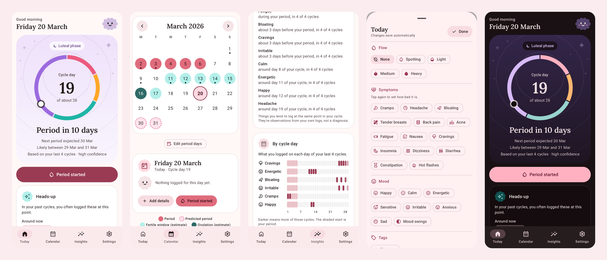
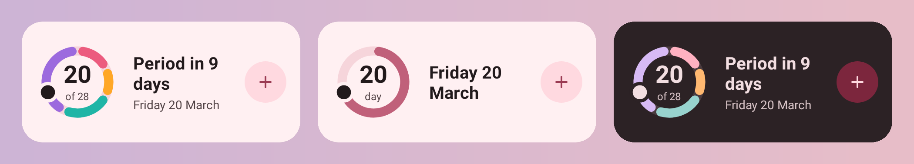

# Cadence

**A private period and birth control tracker for Android. Everything stays on your phone.**

Cadence helps you log your period, see when the next one is likely, notice your own patterns, and keep up with a pill, patch or ring. It has no account, no server and no internet access, and your data is encrypted on the device.

Created by **Mehul Sen**.



## Highlights

- **Private by design.** Cadence doesn't request the `INTERNET` permission, so it can't send anything anywhere. Your data is kept in an encrypted database whose key is protected by the Android Keystore.
- **Predictions from your own history.** Cadence estimates your next period with a likely range and a confidence level, and these get better as you log.
- **Two modes.** Track your natural cycle, or follow a hormonal birth control schedule (pill, patch or ring) with dose check-offs and reminders.
- **Friendly and calm.** It uses Material 3 Expressive, with a little buddy mascot, soft motion and clear icons. Light and dark themes are included, and all motion stops when your phone's animations are off.
- **Yours to keep.** You can make a password-protected backup, export a spreadsheet, or create a PDF report for your clinician.

## Features

### Today
- A cycle ring showing your cycle day and phase (menstrual, follicular, fertile window, luteal), with your next period's expected date, likely range and confidence.
- One-tap **Period started** (with undo), plus quick ways to extend or end a period.
- **Heads-up:** a card that tells you when something you often log at this point in your cycle (cramps, headaches, cravings) is likely around now or tomorrow. It's based on your own logs and isn't a health prediction.
- Phase cards with short, sourced facts.
- On birth control: today's pill, patch or ring, missed doses to confirm, and the next change or break. In the last week of your supply it also shows a reminder to refill.
- A tick list for your other medications.

### Calendar
- Logged period days, predicted periods, estimated fertile days and the estimated ovulation day, each marked clearly. Days with notes or symptoms get a dot.
- Tap any day to see what's logged and add details.
- Log a period that started in the past: Cadence fills in the usual number of days, and predictions update straight away. You can also end a period on a given day, remove single days, or edit period days directly.

### Daily log
- Flow (spotting to heavy), 14 symptoms with severity, 8 moods, pain, energy, sleep, stress, sex, and a private note.
- Your own custom tags, medications taken, and birth control doses.
- Changes save as you go. You can hide any section you don't use.

### Insights
- Average cycle and period length, a cycle-length chart, and the option to leave unusual cycles out of predictions.
- **Patterns:** what you tend to log, and when (for example, "bloating about 3 days before your period, in 4 of 4 cycles").
- **By cycle day:** a grid of your most-logged items across your recent cycles, so you can see at a glance which days things usually show up.
- Informational health notes (very short or long cycles, irregular cycles, long periods, no recent period, severe pain) with a suggestion to talk to a clinician. Cadence never gives a diagnosis.

### Birth control
- Pill (with or without a break, with or without placebo pills), patch and ring schedules, or continuous use.
- Daily dose reminders, missed-dose prompts, and withdrawal bleeds predicted from your pack.
- **Refill reminder:** tell Cadence how many packs you have, and it reminds you 5 days and 1 day before they run out.

### Reminders
- Upcoming period (1 to 7 days ahead), late period, daily log, birth control doses, medications and refills. All are off until you turn them on.
- **Discreet by default:** notifications don't mention periods unless you turn that off.

### Quick logging
- **App shortcuts:** long-press the app icon for *Log today*, plus *Period started* or *Dose done*.
- **Quick Settings tile:** *Log today* from the notification shade.
- **Home-screen widgets:** a small one with your day, and a large one with the cycle ring and a log button.

Every quick action waits until the app is unlocked.



### Privacy and security
- No network access at all, which CI checks on every build.
- The SQLCipher database is encrypted with a key wrapped by the Android Keystore.
- **App lock** with your fingerprint, face or screen lock. You choose whether it locks immediately, after 1 minute or after 5 minutes away.
- Screenshots and the recent-apps preview are blocked by default.
- A **discreet icon** option shows the app as "Planner" with a plain notepad icon and turns off the shortcuts.
- Widgets show nothing while app lock is on, and only the day and date in discreet mode.
- Android cloud backup and phone-to-phone transfer are turned off.
- **Delete all data** erases everything in one step.

### Your data
- **Backup and restore:** a single file encrypted with your password (AES-256-GCM, PBKDF2 with 600,000 iterations). Restoring can replace your data or merge with it.
- **CSV export** for spreadsheets. Fields that a spreadsheet could run as formulas are made safe.
- **Clinician report:** a PDF of your last 3, 6 or 12 months (or everything), covering cycles, periods, symptoms, birth control and medications.
- **Health Connect (optional):** share period days and flow with other health apps, and copy periods from them. Only menstruation data is used, and only after you turn sharing on.

### For everyone
- Available in English and Russian. On Android 13 and later you can choose a language for Cadence alone.
- Built for TalkBack, large text (tested at 200%), right-to-left layouts, and 48dp touch targets. Colours meet WCAG AA contrast, and accessibility checks run on every main screen.
- Runs on Android 8.0 (API 26) and later.

## Install

Cadence is installed directly from its APK; no Play Store is needed.

1. Download the latest `cadence-x.y.z.apk` from the [Releases page](https://github.com/not-mehul/Cadence/releases).
2. *(Recommended)* Check the file is genuine by comparing its SHA-256 checksum with the one in the release notes:
   ```bash
   sha256sum cadence-x.y.z.apk          # macOS: shasum -a 256 cadence-x.y.z.apk
   ```
   After installing, **Settings → About** shows the signing certificate's fingerprint. It's the same for every release and must match the release notes.
3. Open the APK on your phone and allow your browser or file manager to install unknown apps when asked. You can turn that permission off again afterwards.
4. **To update,** install a newer APK over the old one; your data is kept. Cadence can't check for updates itself, so look at the Releases page now and then.
5. **To move to a new phone,** go to **Settings → Your data → Export a backup**, copy the file across, then choose **Restore from a backup** on the new phone's welcome screen.

### Permissions

| Permission | Why |
|---|---|
| Notifications, run at startup | Showing reminders, and setting them again after a restart |
| Biometric, fingerprint | Showing the system's unlock prompt for the optional app lock |
| Health Connect: read and write menstruation | Only if you turn on Health Connect sharing |

There is no internet, location, contacts, storage or advertising ID permission. CI fails any build that asks for something outside this list.

## Under the hood

Cadence is a native Android app written in Kotlin with Jetpack Compose.

| | |
|---|---|
| UI | Jetpack Compose, Material 3 Expressive, Material Symbols, Lora headings |
| Architecture | Multi-module MVVM with unidirectional data flow, Hilt, Kotlin coroutines and Flow |
| Storage | Room on SQLCipher, with a Keystore-wrapped key and tested schema migrations |
| Background | `AlarmManager` for reminders and the widgets' midnight refresh (no WorkManager, no wake locks) |
| Quality | ktlint, Android Lint with warnings as errors, Robolectric and Compose UI tests, device tests with accessibility checks, and 100% line and branch coverage on the cycle logic |

### Project layout

| Module | Contents |
|---|---|
| `:app` | Activity, navigation, Hilt setup, manifest and privacy settings, Quick Settings tile |
| `:core:domain` | Pure Kotlin cycle logic: predictions, phases, birth control schedules, patterns and reminders planning |
| `:core:data` | Encrypted database, repositories, backup format, CSV export |
| `:core:ui` | Theme, colours, shapes, icons, the buddy mascot and shared components |
| `:core:testing` | Fakes and test rules shared by the other modules |
| `:feature:*` | Onboarding, Today, Calendar, Log, Insights, Settings, Reminders, Backup, Widget, Health Connect |
| `build-logic/` | Gradle convention plugins |

### How predictions work

Cadence works out periods and cycles from the days you log. It predicts the next period from your recent cycles, giving more weight to the latest ones, and widens or narrows the likely range depending on how regular you are. The fertile window is estimated by counting back from the expected next period, using your luteal phase length. Cycles you've excluded are left out. On a birth control schedule, bleeds follow your pack's breaks instead.

## Build from source

You need JDK 17 or later and an Android SDK with platform `android-37.0`.

```bash
echo "sdk.dir=/path/to/android-sdk" > local.properties   # or set ANDROID_HOME

./gradlew assembleDebug                         # app/build/outputs/apk/debug/app-debug.apk
./gradlew testDebugUnitTest :core:domain:koverVerify
./gradlew ktlintCheck lint
./gradlew connectedDebugAndroidTest             # needs a device or emulator
scripts/check-apk-permissions.sh app/build/outputs/apk/debug/app-debug.apk

# A minified release build, signed with your debug key:
./gradlew :app:assembleRelease -Pcadence.signWithDebugKey=true
```

Debug builds install as **Cadence (debug)** (`app.cadence.debug`), alongside a release build.

CI runs all of the above on every push. It also runs device tests and a release smoke test on Android 8.0 and Android 16 emulators. Signed releases are made by pushing a version tag; see [`docs/RELEASING.md`](docs/RELEASING.md).

## Credits

Cadence was designed and created by **Mehul Sen**.

- Icons: [Material Symbols](https://fonts.google.com/icons) by Google (Apache License 2.0)
- Heading font: [Lora](https://fonts.google.com/specimen/Lora) (SIL Open Font License 1.1)

## Licence

Cadence is released under the [MIT License](LICENSE). Copyright © 2026 Mehul Sen.

## Disclaimer

Cadence is not a medical device and must not be used as contraception. Predictions are estimates. Talk to a clinician about any health concerns.
